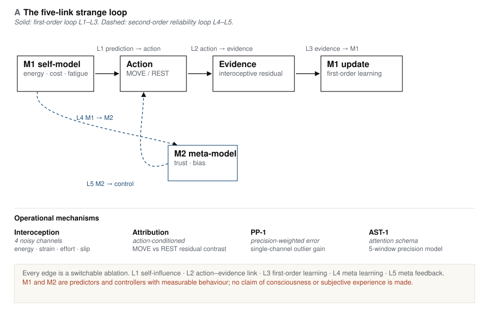
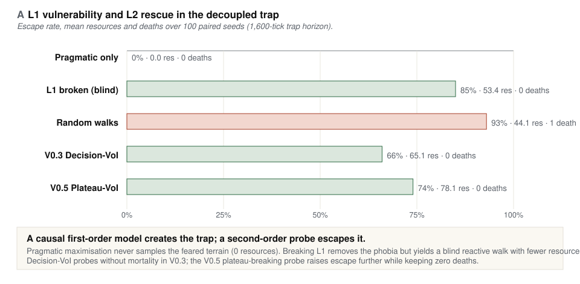
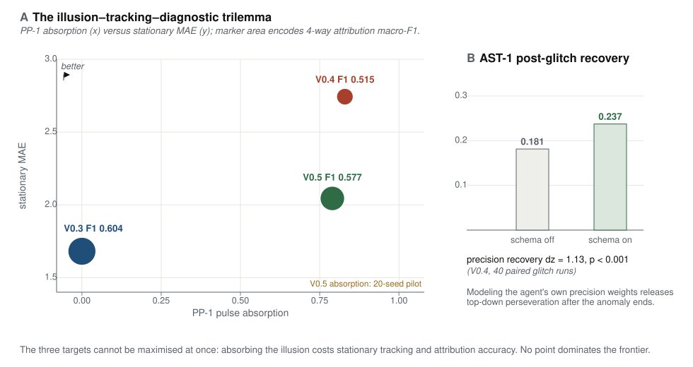
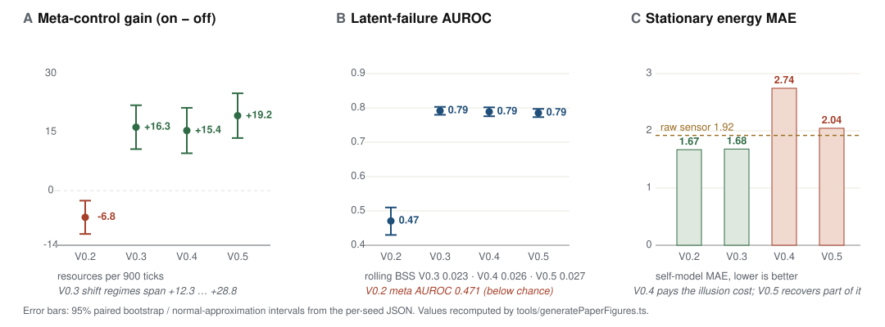

# When Self-Models Trap Themselves: Epistemic Probing, Risk-Sensitive Metacognition, and Precision Trade-Offs in a White-Box Self-Referential Agent


**Anand Jayakumar**

## Abstract

Self-models are usually evaluated as predictors. We ask what happens when a self-model becomes part of the system it models. Strange Loop Lab is a deterministic, non-neural, white-box survival sandbox in which an agent in a 30 × 30 metabolic world learns a first-order model of its own body (M₁), a second-order model of M₁'s reliability (M₂), and — in later generations — a model of its own precision allocation. Across five architectural generations and **19,400 total simulation runs** (100 paired seeds per condition across 13 conditions in V0.1, 23 in V0.2, 52 in V0.3, 54 in V0.4 and 52 in V0.5), we report four findings. (i) A learned self-model is behaviourally inert in a forgiving world: a frozen model with 0.09 self-state accuracy survives 99/100 runs and forages as well as a learned one (64.6 vs 61.0 resources, p = 0.057). Stakes are what make self-modeling matter. (ii) Naive second-order doubt is harmful: meta-on minus meta-off is **−6.84 [−11.11, −2.57]** resources in V0.2, because doubting the self-model disables exhaustion warnings. Asymmetric, risk-sensitive bounds reverse the sign to **+12.34 to +28.82** resources across regimes in V0.3, and **+13.75 to +28.37** in V0.5 (all p < 0.001). (iii) A causal first-order self-model creates a self-fulfilling epistemic trap. Pragmatic maximisation never samples the feared terrain (**0/100** escapes, **0.0** resources); breaking L1 (prediction→action) removes the phobia but yields a blind reactive walk. Second-order decision-value-of-information probing escapes in **66/100** (V0.3) and **74/100** (V0.5) with **zero deaths**, versus **93/100** for random exploration at **44.1** resources and one death. (iv) Precision gating buys illusion absorption at a measured cost: absorbing a top-down interoceptive pulse rises from **0.00** (V0.3) to **0.830** (V0.4), while stationary MAE rises from 1.68 to 2.74 and four-way attribution macro-F1 falls from 0.604 to 0.515. Selective transient gating (V0.5) recovers part of the cost (MAE 2.04; F1 0.577; absorption 0.79 in a 20-seed pilot) but no configuration dominates: the three targets form a **Pareto trilemma**. All mechanisms are predictors and controllers with measurable behaviour. Nothing here is evidence of consciousness or subjective experience.

---

## 1. Introduction and related work

Hofstadter's strange loop is a system that, through a hierarchy of levels, comes to represent the very processes that produce it [1,2]. The idea is attractive and empirically slippery: a loop can be described in many ways, and almost any recurrent controller can be redrawn to look self-referential. This paper takes the opposite route. We build the smallest non-neural system in which a self-model is *causally load-bearing*, ablate each link, and measure what breaks. The result is not a demonstration of consciousness but a quantified account of what self-reference costs and buys.

The work sits at the intersection of four literatures.

**Operationalising consciousness and metacognitive indicators.** Butlin et al. [3] assembled a rubric of indicator properties — recurrent processing, global workspace, higher-order theories, predictive processing, attention schema, agency and embodiment — and asked which computational features are associated with consciousness in the science. Post-2023 applications of that rubric have been largely qualitative, and mostly aimed at black-box language models whose internal variables cannot be identified with a mechanism. Strange Loop Lab is, to our knowledge, the first **mathematically transparent, non-neural, white-box survival sandbox** that jointly operationalises **PP-1** (predictive processing), **HOT-2/3** (higher-order reliability monitoring), **AE-1/2** (agency and embodiment) and **AST-1** (attention schema) under strict counterfactual shadow-probe isolation — and the first to exhibit a quantitative **Pareto trilemma** among them. Every indicator is a named variable in code, every edge is a switch, and every reported number is regenerated from seeded runs.

**Embodied second-order metacognition.** Bayesian accounts of metacognition model confidence as a second-order estimate of first-order performance [4,5]. Most computational treatments are static perceptual wagering tasks. We embed second-order error prediction inside a homeostatic metabolic cliff environment where errors are lethal. Two results follow. First, naive confidence down-scaling *harms* survival: the agent stops trusting its own exhaustion warning and forages until collapse (**−6.84** resources, V0.2). Asymmetric risk-sensitive pessimism near the cliff — not symmetric doubt — produces the gain (**+12.34 to +28.82**). Second, compact one-parameter rolling residuals plus a persistent directional-bias head outperform a high-dimensional online contextual meta-regressor under non-stationary shifts; the contextual model is slightly *worse* than the baseline-only ablation on AUROC (Δ = −0.01 [−0.02, 0.01], p = 0.812).

**Self-fulfilling epistemic traps and active inference.** Active inference treats action selection as minimising expected free energy, with epistemic value driving information-seeking [6,7]. We connect this to the clinical avoidance paradox and to Hofstadterian self-reference. A pragmatic agent that believes rough terrain is catastrophically expensive never visits it, never collects the evidence that would correct the belief, and starves (**0/100** escapes, **0.0** resources). The crucial ablation is **L1**: a blind reactive agent with no causal self-model cannot be trapped by a false metabolic phobia, because it has no prior to act on. Acquiring the self-model creates the vulnerability. Escape requires second-order epistemic probing that is *evidence-discounted*: V0.3's decision-VoI escapes 66/100 with zero deaths; V0.5's plateau-breaking probe raises this to 74/100 at 78.1 resources with zero deaths, while random exploration escapes more often (93/100) but at roughly half the resources and with a death.

**Internal precision and the attention schema.** Attention Schema Theory proposes that the brain models its own attentional state and that this model is what makes attention reportable [8,9]. AST work has mostly targeted external visual selection. We extend AST-1 to **internal 5-channel precision allocation**: M₂ estimates the agent's own precision weights over interoceptive channels, and the schema gates prior versus sensory gain. The test is post-glitch perseveration. After a transient single-channel anomaly ends, a precision filter can remain stuck distrusting the sensor. Modelling its own precision state lets the agent notice that the disagreement is gone and release suppression: recovery gain **0.237 vs 0.181 without the schema (dz = 1.13, p < 0.001)**.

**Contributions.** (1) A preserved five-generation ladder (V0.1 → V0.5) with 100 paired seeds each, released with raw per-run JSON. (2) A causal demonstration that self-model acquisition creates epistemic traps (L1 vulnerability) and that second-order probing resolves them (L2 rescue). (3) An asymmetric risk-sensitive control result showing why symmetric metacognitive doubt fails. (4) A quantitative illusion–tracking–diagnostic trilemma with a measured Pareto frontier rather than a single headline number. (5) A reproducibility and reporting protocol that keeps negative and partial results in the record.

---

## 2. Environment, architecture, and escaping the minimal-implementation trap

### 2.1 The world

The world is a 30 × 30 grid with obstacles (density 0.115) and resource cells (density 0.052). The agent has position, energy, fatigue and a movement cost. Energy is spent per step,

```text
E(t+1) = E(t) − c(a,t) + r(t) − δ_death
c(a,t) = c₀ · (1 + β·F(t)) · η(t)
```

where `c₀` is the base movement cost, `F(t)` fatigue, `β = 1.35` the fatigue-cost slope, and `η(t)` a slip/terrain factor. Rest restores energy (`+2.7`) and relieves fatigue (`−0.16`). Resource cells return `+24` energy. Death occurs at zero energy. The environment is deterministic given the seed; resource regrowth follows a seeded schedule.

Rough terrain is a decoupled cost field with its own parameter `roughCost`. In the trap condition, an injected pessimistic prior sets `roughCost = 25` while the true value is `2.2`. Crucially, the agent can only learn the true cost by *visiting* rough cells; the belief and the evidence are decoupled.

### 2.2 Interoception

The agent does not read the physical state. It receives four noisy channels: energy, strain (fatigue), effort (last movement cost) and slip. Each is corrupted by Gaussian noise (`σ = 2.4`), with an 8% stale-sample probability. In V0.2 and later, the observation is filtered by a learned self-model; in V0.4 and later, by a precision-weighted filter.

### 2.3 The V0.1 audit and the "minimal implementation" trap

V0.1 used designer-set priors. Its self-model was learned, but the world was forgiving enough that a **frozen** model — one that never updated — survived **99/100** runs and collected **64.6** resources versus **61.0** for the learned model (paired difference −3.5, p = 0.057). The frozen model's self-state accuracy was **0.09**, i.e. it was wrong about its own body almost always, and it did not matter.

This is the minimal-implementation trap: an architecture can contain a self-model, a meta-model and a strange loop, and still be behaviourally inert because the environment never charges for being wrong. V0.2 made three changes: randomized uninformed priors, a true metabolic cliff where small prediction errors kill, and a learned meta-model over the self-model's reliability. The audit result is the first substantive finding of the programme: **stakes, not architecture, are what make self-modeling load-bearing.**

### 2.4 V0.2: uninformed priors and learned reliability

V0.2 samples the self-model's initial parameters from a broad, uninformed distribution rather than hand-setting them. A second-order model tracks the first-order model's prediction error and outputs a tolerance probability `p(tol)` and an uncertainty estimate. The self-model is

```text
M₁:  ŷ(t+1) = f_θ(y(t), a(t)),     θ ← θ + α·∇_θ log p(y | θ)
```

with `α` adapted from the meta-model's reliability estimate. On the standard condition, V0.2 reaches a stationary energy MAE of **1.67 [1.66, 1.68]**, slightly better than the raw interoceptive signal (**1.92 [1.91, 1.93]**): the self-model is a genuine super-sensory filter.

But the second-order loop is miswired. Meta-on minus meta-off is **−6.84 [−11.11, −2.57]** resources: turning the meta-model on makes the agent forage *worse*. The mechanism is diagnostic. When the meta-model doubts the self-model's energy estimate, it down-weights the self-model's contribution to action selection. The self-model is exactly the component that warns about exhaustion. Doubt therefore removes the warning. Confidence calibration improves while survival degrades — a concrete case of a metacognitive objective that is locally sensible and globally harmful.

V0.2 also shows that the meta-model can *rank* latent failures (rolling BSS −0.12, latent AUROC 0.471, below chance) without being able to use that ranking causally. Reliability estimation and reliability *control* are separate problems.

---



## 3. Closing the second-order loop: residual metacognition and risk-sensitive control (V0.3)

### 3.1 Residual meta-model

V0.3 replaces the monolithic second-order model with a residual architecture:

```text
p̂ = p_base + w · (p_ctx − p_base),      w ← shrink(‖p_ctx − p_base‖)
```

A one-parameter rolling base tracks the level of the error signal; a compact contextual head predicts the residual; the residual is shrunk toward zero by its own squared loss. A persistent-failure head emits a directional bias that survives across ticks. This is deliberately low-dimensional. Under non-stationary shifts, a high-capacity online regressor chases noise, while the rolling base plus residual separates level from context.

### 3.2 Risk-sensitive cliff control

The meta-model's reliability estimate does not scale the self-model's influence symmetrically. Instead, it gates a pessimistic bound:

```text
ŷ* = ŷ + δ − k·ê   (near cliff),    ŷ* = ŷ + δ + 0.1·ê   (otherwise)
```

where `ê` is the estimated error and `k` the risk gain. Near the energy cliff, the agent acts on a *lower* bound of its energy estimate; away from it, it behaves close to the point estimate. This asymmetry is the whole result. Symmetric doubt removes the exhaustion warning; asymmetric pessimism keeps the warning and adds caution.

Across eight regimes, meta-on beats meta-off by **+12.34 to +28.82** resources (dz 0.45–1.13, all p < 0.001). In the standard condition the paired gain is **+16.26 [10.64, 21.88]**. Severe-prior survival is 100/100 with meta on versus 93/100 with meta off. Meta-control is no longer a calibration exercise; it is a survival mechanism.

### 3.3 Skill-gated world model and temporal attribution

The world model is blended with a neutral prior by `√skill`, where skill is the model's demonstrated predictive accuracy in the current context. An unverified model therefore behaves like no model until it earns influence. Attribution compares the residual under MOVE with the residual under REST:

```text
Δ_channel = |r_channel(MOVE)| − |r_channel(REST)|
```

A physical shift moves all channels together; a sensor fault moves one channel regardless of action; a fatigue fault appears in strain and cost but not in energy. The four-way classifier assigns physical, energy-sensor, fatigue-sensor or shared, with an `insufficient` class when evidence is weak.

### 3.4 V0.2 versus V0.3 at N = 100

| Measure (100 paired seeds) | V0.2 | V0.3 |
| --- | --- | --- |
| Resources, standard | 32.41 [28.10, 36.72] | **42.10 [37.83, 46.37]** |
| Stationary energy MAE | 1.67 | 1.68 |
| Latent failure AUROC | 0.471 | **0.792 [0.780, 0.803]** |
| Rolling BSS | −0.12 | **+0.023 [0.022, 0.024]** |
| 4-way attribution macro-F1 | 0.25 | **0.604** |
| Trap escape (pragmatic / VoI) | 0 / 0 | **0/100 / 66/100** |
| Meta-on − meta-off | −6.84 [−11.11, −2.57] | **+16.26 [10.64, 21.88]** |

V0.3 is the strongest overall version. It sets the Pareto frontier that V0.4 and V0.5 trade against.

---

## 4. The self-fulfilling epistemic trap: L1 vulnerability and L2 rescue

### 4.1 The trap

The decoupled rough-terrain trap installs a false belief that rough terrain costs 25 energy per step while the true cost is 2.2. A pragmatic agent maximises expected value under its belief. Crossing rough terrain looks catastrophic, so it never crosses, never observes the true cost, and never corrects the belief. Because resource cells are rough terrain, it also never eats. Escape rate: **0/100**, resources **0.0**. The uncertainty-bonus agent fails identically (0/100): an undirected bonus is not enough when the agent's model says the probe is lethal.

This is the computational analogue of the avoidance paradox. The belief is not irrational given the evidence the agent permits itself to collect. The trap is epistemic, not motivational.

### 4.2 L1 creates the vulnerability, L2 rescues it

The five-link loop is `M₁ → action → evidence → M₁ update`, with `M₂` reading `M₁` and feeding back into control. Ablating each link in the trap condition (100 seeds) gives:

| Link broken | Trap escape | Trap resources | Post-shift MAE | Post-shift resources |
| --- | --- | --- | --- | --- |
| None (full V0.5) | 74/100 | 78.1 | 1.87 | 38.4 |
| L1 prediction → action | **85/100** | 53.4 | 1.62 | 22.2 |
| L2 action → evidence | **0/100** | 12.4 | 29.41 | 8.0 |
| L3 evidence → M₁ | 0/100 | 23.6 | 29.12 | 20.9 |
| L4 M₁ → M₂ | 80/100 | 57.5 | 1.88 | 37.2 |
| L5 M₂ → control | **4/100** | 3.2 | 1.45 | 20.1 |

L1 is the vulnerability. Breaking it removes the phobia and raises escape to 85/100, but the agent becomes a blind reactive walk: it loses 24 resources relative to the full agent, and under a physical regime shift it survives on 22.2 resources with a worse safety margin. The self-model is what makes the trap possible *and* what makes competent foraging possible. There is no free "just be reactive" option.

L2 is the rescue. Breaking the action→evidence link collapses escape to 0/100, survival under a physical shift to 1/100, and MAE to 29.41: without the ability to attribute outcomes to its own actions, the agent cannot distinguish a world change from a sensor fault. L3 shows the same signature: freezing first-order learning leaves the model at 29 MAE and escape at 0/100.

L5 is the control link: removing meta feedback drops escape to 4/100 and resources to 3.2, close to the pragmatic baseline. The meta-model must be able to *act* on its reliability estimate, not merely track it.

### 4.3 Probing strategies

| Strategy | Escape | Resources | Deaths |
| --- | --- | --- | --- |
| Pragmatic only | 0/100 | 0.0 | 0 |
| Uncertainty bonus | 0/100 | 0.0 | 0 |
| L1 broken (blind reactive) | 85/100 | 53.4 | 0 |
| Random exploration | 93/100 | 44.1 | 1 |
| V0.3 decision-VoI | 66/100 | 65.1 | 0 |
| V0.5 plateau-VoI | **74/100** | **78.1** | **0** |



Decision-VoI computes the value of sampling a never-observed rough context and compares it with the pessimistic cost bound. Because the probe has decision value only when the resulting belief could change the policy, the agent takes the risk exactly when it matters. VoI versus pragmatic is **+78.14 [69.29, 87.10]** resources (dz 1.69, p < 0.001); versus random it is **+34.03 [24.01, 43.69]** (dz 0.68, p < 0.001). Random exploration escapes more often but at roughly half the resources and with a death; VoI trades a small amount of escape rate for a large amount of foraging.

V0.5's evidence-discounted gate and plateau-breaking probe raise escape to 74/100 and resources to 78.1 with zero deaths. The remaining 26 failures are energy plateaus below even the discounted floor: the agent's energy is too low to afford the probe, so the rest policy is locally optimal. Escape is therefore bounded by physiology, not by belief.

---

## 5. Precision predictive coding, the attention schema, and the trilemma

### 5.1 PP-1: precision-weighted filtering

V0.4 introduces a precision-weighted filter. Each channel has a precision weight `π_i`; the posterior gain is a precision ratio:

```text
K_i = π_i / (π_i + σ_i²·λ),      ŷ_i ← ŷ_i + K_i·(y_i − ŷ_i)
```

A single-channel outlier collapses the precision of that channel for one tick, absorbing a transient illusion. Sustained cross-channel disagreement instead erodes the prior precision. The intended consequence is a short, bounded influence of a spurious pulse.

### 5.2 AST-1: a schema over internal precision

AST-1 adds a five-window model of the agent's own precision weights. The schema estimates whether the agent is currently in a high-prior or high-sensor mode, and releases suppression when the disagreement that justified it has ended. The behavioural signature is post-glitch recovery: after a transient sensor anomaly, a filter without the schema remains stuck in a distrustful mode; with the schema, the agent returns to its normal gain.

In V0.4, schema-on versus schema-off recovery is **0.237 vs 0.181** (40 paired glitch runs, dz = 1.13, p < 0.001). The effect is smaller in V0.5 because selective gating already avoids most normal-operation suppression, leaving less perseverance for the schema to release.

### 5.3 The illusion–tracking–diagnostic trilemma

| Version | PP-1 absorption | Stationary MAE | Attribution macro-F1 | Trap escape |
| --- | --- | --- | --- | --- |
| V0.3 | ≈0.00 | **1.68** | **0.604** | 66/100 |
| V0.4 | **0.830 [0.811, 0.848]** | 2.74 | 0.515 | 65/100 |
| V0.5 | 0.79 (20-seed pilot) | 2.04 | 0.577 | **74/100** |



The three targets cannot be maximised at once. Absorbing the illusion requires trusting the prior, which is the same gain that slows tracking. In V0.4 the cost is explicit: absorption rises from zero to 0.830 while stationary MAE rises from 1.68 to 2.74 and attribution macro-F1 falls from 0.604 to 0.515. V0.5's selective gating recovers part of the tracking cost (MAE 2.04) and part of the diagnostic cost (F1 0.577), but it does not reach V0.3's accuracy, and its absorption is measured only in the 20-seed pilot because the 100-seed harness still runs the legacy illusion probe.

The trilemma is the paper's central negative result. It is a *frontier*, not a failure of implementation: each point is the best achievable given the same precision gain, and moving along the frontier changes which capability is sacrificed.

At the full protocol V0.5 also reaches rolling BSS **0.027 [0.025, 0.028]** and latent-failure AUROC **0.785 [0.773, 0.797]**, and the learned world model beats the neutral ablation by **+4.72 [0.77, 8.68]** resources (dz 0.22, p = 0.027). The world-model advantage lost in V0.4 is therefore recovered, but at a tracking and diagnostic cost.



### 5.4 The Goodhart check

A local metacognitive score can improve while system outcomes do not. We therefore test whether lower meta-Brier loss predicts more resources across seeds. The correlation is **r = 0.313**, and the induced resource change is **+0.57 [−3.47, 4.73]** (n.s.). Local calibration and system-level success are related but not substitutable. An indicator programme that optimises the local score without checking the system outcome would report progress that the agent does not experience as improved survival.

---

## 6. Discussion, limitations, and reproducibility

**Why negative results matter.** The V0.1 audit, the V0.2 sign error, the V0.4 tracking cost and the V0.5 non-Pareto outcome are not appendix material; they are the evidence that the indicator properties are doing work. A benchmark that reported only the V0.3 breakthrough would invite Goodharting: the next architecture could maximise the reported indicator while degrading the system it is supposed to explain. Reporting the frontier makes that trade visible.

**Functional versus phenomenal.** M₁ and M₂ are predictors and controllers. "Self-model", "meta-model", "attention schema" and "strange loop" name computational objects with measurable behaviour. The lab does not claim that the agent is conscious, sentient or has subjective experience, and no metric is labelled a consciousness score. The contribution to the science of consciousness is methodological: a transparent testbed in which indicator properties can be operationalised, ablated and priced.

**Limitations.** The world is small and discrete; the agent is non-neural; the horizon is 900 ticks (1,600 in traps); the reported generations are five architectures, not a search over architectures. The 20-seed PP-1 pilot for V0.5 and the 40-run AST estimate in V0.4 are smaller samples than the main protocol and are flagged as such. The 100-seed harness does not re-estimate absorption for V0.5. Generalisation to neural or open-ended systems is not claimed.

**Future work.** Four questions follow directly from this record. (1) A preregistered sweep of the precision-decay and AST-1 recovery parameters would map a continuous Pareto frontier instead of the five architectural points sampled here. (2) Decision-VoI and plateau preparation should be stress-tested under multi-step lookahead, delayed or ambiguous effort feedback, and environments where rough terrain is occasionally genuinely lethal. (3) Temporal attribution should be separated into calibration and discrimination under explicitly held-out shift schedules, particularly for the physical-versus-fatigue confusion. (4) The observable-outcome interface used by the learning calls in V0.2–V0.5 should be extended to every evaluation reachable from agent code, so the no-ground-truth guarantee is auditable end to end by the type system rather than by code review alone.

**Reproducibility.** Every run is seeded and deterministic. The repository preserves all five engines, their tests, dashboards and reports. Commands:

```text
npm run validate        # V0.1, 100 seeds
npm run validate:v02    # V0.2, 100 seeds
npm run validate:v03    # V0.3, 100 seeds
npm run validate:v04    # V0.4, 100 seeds
npm run validate:v05    # V0.5, 100 seeds (SEEDS=100 default)
npm run paper:figures   # regenerate paper/figures/*.svg from research/*.json
npm run typecheck && npm test && npm run build
```

Raw per-run JSON is in `research/`; aggregate reports are in `docs/`. The UI exposes the same numbers with plain-English and statistical layers.

**AI assistance disclosure.** The code, validation harnesses and manuscript were produced with AI-assisted drafting and statistical auditing. All numbers in the manuscript are generated from the seeded JSON artifacts by the validation harnesses and the figure generator, and were independently re-read from those artifacts during editing. No number was typed from memory.

---

## References

1. Hofstadter, D. R. (1979). *Gödel, Escher, Bach: An Eternal Golden Braid*. Basic Books.
2. Hofstadter, D. R. (2007). *I Am a Strange Loop*. Basic Books.
3. Butlin, P., Long, R., Elmoznino, E., Bengio, Y., Birch, J., Constant, A., Deane, G., Fleming, S. M., Frith, C., Ji, X., Kanai, R., Klein, C., Lindsay, G., Michel, M., Mudrik, L., Peters, M. A. K., Schwitzgebel, E., Simon, J., & VanRullen, R. (2023). Consciousness in artificial intelligence: Insights from the science of consciousness. *arXiv:2308.08708*.
4. Fleming, S. M., & Daw, N. D. (2017). Self-evaluation of decision-making: A general Bayesian framework for metacognitive computation. *Psychological Review, 124*(1), 91–114.
5. Pasquali, A., Timmermans, B., & Cleeremans, A. (2010). Know thyself: Metacognitive networks and measures of consciousness. *Cognition, 117*(2), 182–190.
6. Friston, K., Rigoli, F., Ognibene, D., Mathys, C., Fitzgerald, T., & Pezzulo, G. (2015). Active inference and epistemic value. *Cognitive Neuroscience, 6*(4), 187–214.
7. Tschantz, A., Seth, A. K., & Buckley, C. L. (2020). Learning action-oriented models through active inference. *PLOS Computational Biology, 16*(4), e1007805.
8. Graziano, M. S. A. (2013). *Consciousness and the Social Brain*. Oxford University Press.
9. Wilterson, A. I., & Graziano, M. S. A. (2021). The attention schema theory in a neural network agent: Controlling visuospatial attention using a descriptive model of attention. *PNAS, 118*(33), e2102421118.
10. Tschantz, A., Millidge, B., Seth, A. K., & Buckley, C. L. (2022). Simulating homeostatic, allostatic and goal-directed forms of interoceptive control. *Biological Psychology, 169*, 108266.
11. Conant, R. C., & Ashby, W. R. (1970). Every good regulator of a system must be a model of that system. *International Journal of Systems Science, 1*(2), 89–97.
12. Baars, B. J. (1988). *A Cognitive Theory of Consciousness*. Cambridge University Press.
13. Kalman, R. E. (1960). A new approach to linear filtering and prediction problems. *Journal of Basic Engineering, 82*(1), 35–45.
14. Brier, G. W. (1950). Verification of forecasts expressed in terms of probability. *Monthly Weather Review, 78*(1), 1–3.

---
