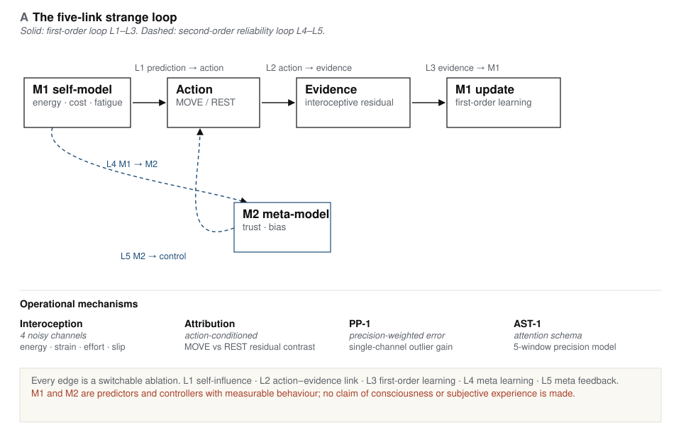
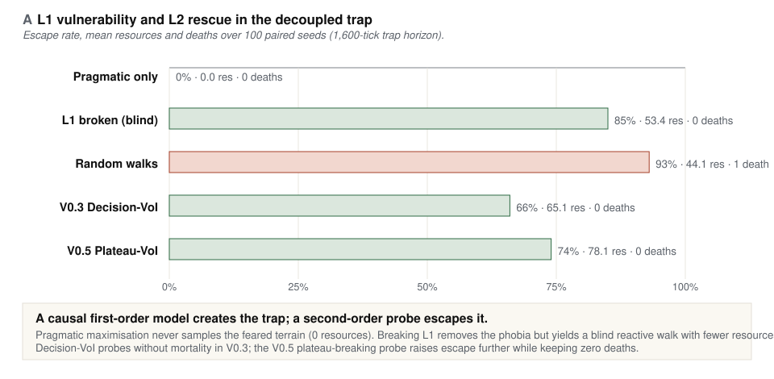
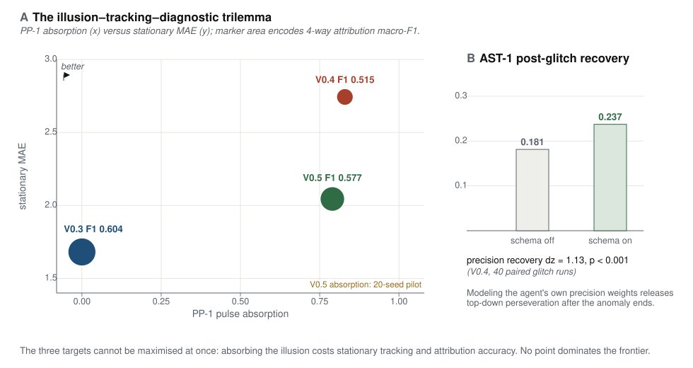
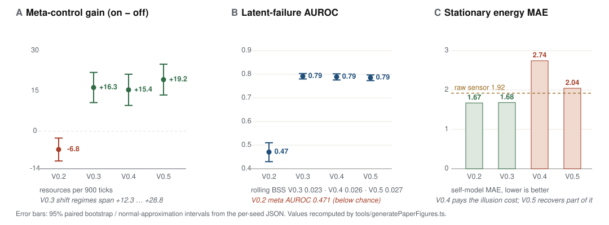

# When Self-Models Trap Themselves: Causal Ablations, Functional Dissociation, and Precision Trade-Offs of Consciousness Indicators in a White-Box Agent


**Anand Jayakumar**

## Abstract

Self-models are usually evaluated as predictors. We ask what happens when a self-model becomes part of the system it models. Strange Loop Lab is a deterministic, non-neural, white-box sandbox where an agent learns a body model (M₁), a model of its reliability (M₂), and later a model of its own precision allocation.

Across six generations (V0.1–V0.6) and 28,100 main-protocol runs (28,900 including 800 V0.1 corruption probes; 100 paired seeds per condition, plus an untouched 100-seed V0.6 holdout and 6,200 hardening episodes), we report five findings. (i) In the tested architecture and environment, a learned self-model is behaviourally inert in a forgiving world: a frozen model with 0.09 self-state accuracy survives 99/100 runs and forages as well as a learned one (64.6 vs 61.0 resources, p = 0.057; no statistically distinguishable advantage, not formal equivalence). (ii) Naive second-order doubt is harmful (−6.84 resources); closing the second-order loop reverses the sign (+12.3 to +28.8), but a 2×2 factorial shows the gain is loop-level rather than attributable to the risk-sensitive bound or residual model alone. (iii) A policy-relevant body–terrain cost model creates a self-confirming epistemic trap—0/100 pragmatic escapes—while second-order probing escapes it in 66–74/100 runs with zero deaths. (iv) Precision gating buys illusion absorption (0.00 → 0.830) at a measured tracking and attribution cost, forming an observed three-way trade-off. (v) In V0.6, ablating competition, broadcast, higher-order monitoring, the attention schema, cognitive self-simulation or recurrent settling each breaks a distinct capability, an ablation-based functional dissociation; a matched physical MPC planner probes 2% and solves 1% of forks versus 94%/84% for the full architecture.

Costs remain explicit: attribution macro-F1 is 0.502, shadow AUROC remains below 0.75, and flat or reactive controls out-forage the architecture. An untouched 100-seed holdout reproduces the full-architecture pattern (absorption 0.808 vs 0.814; fork 85% vs 84%; macro-F1 0.501 vs 0.502). Nothing here is evidence of consciousness or subjective experience.

---

## 1. Introduction and related work

Hofstadter's strange loop is a system that, through a hierarchy of levels, comes to represent the very processes that produce it [1,2]. The idea is attractive and empirically slippery: a loop can be described in many ways, and almost any recurrent controller can be redrawn to look self-referential. This paper takes the opposite route. We build the smallest non-neural system in which a self-model is *causally load-bearing*, ablate each link, and measure what breaks. The result is not a demonstration of consciousness but a quantified account of what self-reference costs and buys.

The work sits at the intersection of four literatures.

**Operationalising consciousness and metacognitive indicators.** Butlin et al. [3] assembled a rubric of indicator properties — recurrent processing, global workspace [12], higher-order theories, predictive processing, attention schema, agency and embodiment — and asked which computational features are associated with consciousness in the science. Post-2023 applications of that rubric have been largely qualitative, and mostly aimed at black-box language models whose internal variables cannot be identified with a mechanism. Strange Loop Lab is a **mathematically transparent, non-neural, white-box survival sandbox** that jointly operationalises **RPT-1/2** (recurrent processing), **GWT-1–4** (global workspace and broadcast), **PP-1** (predictive processing), **HOT-2/3** (higher-order reliability monitoring), **AE-1/2** (agency and embodiment) and **AST-1** (attention schema) under strict counterfactual shadow-probe isolation, and it exhibits a quantitative **observed three-way trade-off** among them. Every indicator is a named variable in code, every edge is a switch, and every reported number is regenerated from seeded runs.

**Embodied second-order metacognition.** Bayesian accounts of metacognition model confidence as a second-order estimate of first-order performance [4,5]. Most computational treatments are static perceptual wagering tasks. We embed second-order error prediction inside a homeostatic metabolic cliff environment where errors are lethal. Two results follow. First, naive confidence down-scaling *harms* survival: the agent stops trusting its own exhaustion warning and forages until collapse (**−6.84** resources, V0.2). Asymmetric risk-sensitive pessimism near the cliff — not symmetric doubt — produces the gain (**+12.34 to +28.82**). Second, compact one-parameter rolling residuals plus a persistent directional-bias head outperform a high-dimensional online contextual meta-regressor under non-stationary shifts; the contextual model is slightly *worse* than the baseline-only ablation on AUROC (Δ = −0.01 [−0.02, 0.01], p = 0.812).

**Self-fulfilling epistemic traps and active inference.** Active inference treats action selection as minimising expected free energy, with epistemic value driving information-seeking [6,7]. Homeostatic and allostatic interoceptive control formalises the same loop for bodily regulation [10]. We connect this to the clinical avoidance paradox and to Hofstadterian self-reference. A pragmatic agent that believes rough terrain is catastrophically expensive never visits it, never collects the evidence that would correct the belief, and starves (**0/100** escapes, **0.0** resources). The crucial ablation is **L1**: a blind reactive agent with no causal self-model cannot be trapped by a false metabolic phobia, because it has no prior to act on. Acquiring the self-model creates the vulnerability. Escape requires second-order epistemic probing that is *evidence-discounted*: V0.3's decision-VoI escapes 66/100 with zero deaths; V0.5's plateau-breaking probe raises this to 74/100 at 78.1 resources with zero deaths, while random exploration escapes more often (93/100) but at roughly half the resources and with a death.

**Internal precision and the attention schema.** Attention Schema Theory proposes that the brain models its own attentional state and that this model is what makes attention reportable [8,9]. AST work has mostly targeted external visual selection. We extend AST-1 to **internal 5-channel precision allocation**: M₂ estimates the agent's own precision weights over interoceptive channels, and the schema gates prior versus sensory gain. The test is post-glitch perseveration. After a transient single-channel anomaly ends, a precision filter can remain stuck distrusting the sensor. Modelling its own precision state lets the agent notice that the disagreement is gone and release suppression: recovery gain **0.237 vs 0.181 without the schema (dz = 1.13, p < 0.001)**.

**Contributions.** (1) A preserved six-generation ladder (V0.1 → V0.6) with 100 paired seeds each, released with raw per-run JSON. (2) A causal demonstration that a policy-relevant body–terrain cost model creates a self-confirming epistemic trap (L1 vulnerability) and that second-order probing resolves it (L2 rescue). (3) An asymmetric risk-sensitive control result showing why symmetric metacognitive doubt fails. (4) A quantitative illusion–tracking–diagnostic trade-off with a measured frontier rather than a single headline number. (5) A unified-architecture ablation-based functional dissociation: capacity competition, broadcast, higher-order monitoring, an attention schema, cognitive self-simulation and recurrent settling are each load-bearing for a different capability. (6) A reproducibility and reporting protocol that keeps negative and partial results in the record.

---

## 2. Environment, architecture, and escaping the minimal-implementation trap

### 2.1 The world

The world is a 30 × 30 grid with obstacles (density 0.115) and resource cells (density 0.052). The agent has position, energy, fatigue and a movement cost. Energy is spent per step,

```text
E(t+1) = E(t) − c(a,t) + r(t) − δ_death
c(a,t) = c₀ · (1 + β·F(t)) · η(t)
```

where `c₀` is the base movement cost, `F(t)` fatigue, `β = 1.35` the fatigue-cost slope, and `η(t)` a slip/terrain factor. Rest restores energy (`+2.7`) and relieves fatigue (`−0.16`). Resource cells return `+24` energy. Death occurs at zero energy. The environment is deterministic given the seed; resource regrowth follows a seeded schedule.

Rough terrain is a decoupled cost field with its own parameter `roughCost`. In the trap condition, an injected pessimistic prior sets `roughCost = 25` while the true value is `2.2`. Crucially, the agent can only learn the true cost by *visiting* rough cells; the belief and the evidence are decoupled.

### 2.2 Interoception

The agent does not read the physical state. It receives four noisy channels: energy, strain (fatigue), effort (last movement cost) and slip. Each is corrupted by Gaussian noise (`σ = 2.4`), with an 8% stale-sample probability. In V0.2 and later, the observation is filtered by a learned self-model; in V0.4 and later, by a precision-weighted filter.

### 2.3 The V0.1 audit and the "minimal implementation" trap

V0.1 used designer-set priors. Its self-model was learned, but the world was forgiving enough that a **frozen** model — one that never updated — survived **99/100** runs and collected **64.6** resources versus **61.0** for the learned model (paired difference −3.5, p = 0.057). The frozen model's self-state accuracy was **0.09**, i.e. it was wrong about its own body almost always, and it did not matter.

In the tested architecture and environment, this is the minimal-implementation trap: an architecture can contain a self-model, a meta-model and a strange loop, and still be behaviourally inert because the environment never charges for being wrong. Regulation requires a model of the regulated system [11], but the converse does not hold: an accurate model imposes no cost when its errors are harmless. V0.2 made three changes: randomized uninformed priors, a true metabolic cliff where small prediction errors kill, and a learned meta-model over the self-model's reliability. The audit result is the first substantive finding of this programme: **in the tested architecture and environment, stakes, not architecture, are what make self-modeling load-bearing.**

### 2.4 V0.2: uninformed priors and learned reliability

V0.2 samples the self-model's initial parameters from a broad, uninformed distribution rather than hand-setting them. A second-order model tracks the first-order model's prediction error and outputs a tolerance probability `p(tol)` and an uncertainty estimate. The self-model is

```text
M₁:  ŷ(t+1) = f_θ(y(t), a(t)),     θ ← θ + α·∇_θ log p(y | θ)
```

with `α` adapted from the meta-model's reliability estimate. On the standard condition, V0.2 reaches a stationary energy MAE of **1.67 [1.66, 1.68]**, slightly better than the raw interoceptive signal (**1.92 [1.91, 1.93]**): the self-model is a genuine super-sensory filter.

But the second-order loop is miswired. Meta-on minus meta-off is **−6.84 [−11.11, −2.57]** resources: turning the meta-model on makes the agent forage *worse*. The mechanism is diagnostic. When the meta-model doubts the self-model's energy estimate, it down-weights the self-model's contribution to action selection. The self-model is exactly the component that warns about exhaustion. Doubt therefore removes the warning. Confidence calibration improves while survival degrades — a concrete case of a metacognitive objective that is locally sensible and globally harmful.

V0.2 also shows that the meta-model fails to *rank* latent failures (rolling BSS −0.12, latent AUROC 0.471, below chance) without being able to use that ranking causally. Reliability estimation and reliability *control* are separate problems.

---



### 2.5 Statistical methodology

The seed is the experimental unit: every test treats paired seeds as independent units and never treats individual ticks or within-run observations as replicates. For a contrast A − B, each seed contributes one paired difference `d_s`; the reported effect is the mean of `d_s`. Two-sided p-values come from a **Monte Carlo paired sign-flip permutation test** with 2,000 randomly sampled sign assignments and the finite-sample +1 correction, `p = (b + 1)/(B + 1)`. This is an approximation, not an exhaustive enumeration; the minimum attainable p-value is 1/2001 ≈ 0.0005. Ninety-five percent confidence intervals are seed-level percentile bootstrap intervals (2,000 resamples). Effect sizes are Cohen's `d_z = mean(d_s)/sd(d_s)`. Holm–Bonferroni correction is applied within each analysis family returned by the analyzer (the five indicator experiments and the metric groups within each experiment); these families were specified in the analysis code, not in an independently dated preregistration. Every condition–seed cell produced a complete deterministic run, so there were zero missing or incomplete runs; deaths are outcomes, not missing data. Sample sizes differ by design and are reported with each result: 100 paired seeds for the main protocol, the 2 × 2 factorial cells and each sweep point; 40 paired glitch runs for the V0.4 AST-1 estimate; and 20 seeds for the V0.5 PP-1 absorption pilot. Seeds 1–100 are the exploratory/development set. The V0.6 holdout replication uses seeds 10001–10100 exactly once, with no development, figure-construction or tuning use, and is reported separately.

## 3. Closing the second-order loop: residual metacognition and risk-sensitive control (V0.3)

### 3.1 Residual meta-model

V0.3 replaces the monolithic second-order model with a residual architecture:

```text
p̂ = p_base + w · (p_ctx − p_base),      w ← shrink(‖p_ctx − p_base‖)
```

A one-parameter rolling base tracks the level of the error signal; a compact contextual head predicts the residual; the residual is shrunk toward zero by its own squared loss. A persistent-failure head emits a directional bias that survives across ticks. This is deliberately low-dimensional. Under non-stationary shifts, a high-capacity online regressor chases noise, while the rolling base plus residual separates level from context.

### 3.2 Risk-sensitive cliff control

The meta-model's reliability estimate does not scale the self-model's influence symmetrically. Instead, it gates a pessimistic bound:

```text
ŷ* = ŷ + δ − k·ê   (near cliff),    ŷ* = ŷ + δ + 0.1·ê   (otherwise)
```

where `ê` is the estimated error and `k` the risk gain. Near the energy cliff, the agent acts on a *lower* bound of its energy estimate; away from it, it behaves close to the point estimate. This asymmetry is the whole result. Symmetric doubt removes the exhaustion warning; asymmetric pessimism keeps the warning and adds caution.

Across eight regimes, meta-on beats meta-off by **+12.34 to +28.82** resources (dz 0.45–1.13, all p < 0.001). In the standard condition the paired gain is **+16.26 [10.64, 21.88]**. Severe-prior survival is 100/100 with meta on versus 93/100 with meta off. This is the loop-level contrast (meta feedback on versus off), not the isolated risk-bound effect; the 2 × 2 decomposition in §3.5 shows the gain is not attributable to the risk bound alone. Meta-control is no longer a calibration exercise; it is a survival mechanism.

### 3.3 Skill-gated world model and temporal attribution

The world model is blended with a neutral prior by `√skill`, where skill is the model's demonstrated predictive accuracy in the current context. An unverified model therefore behaves like no model until it earns influence. Attribution compares the residual under MOVE with the residual under REST:

```text
Δ_channel = |r_channel(MOVE)| − |r_channel(REST)|
```

A physical shift moves all channels together; a sensor fault moves one channel regardless of action; a fatigue fault appears in strain and cost but not in energy. The four-way classifier assigns physical, energy-sensor, fatigue-sensor or shared, with an `insufficient` class when evidence is weak.

### 3.4 V0.2 versus V0.3 at N = 100

| Measure (100 paired seeds) | V0.2 | V0.3 |
| --- | --- | --- |
| Resources, standard | 32.41 [28.10, 36.72] | **42.10 [37.83, 46.37]** |
| Stationary energy MAE | 1.67 | 1.68 |
| Latent failure AUROC | 0.471 | **0.792 [0.780, 0.803]** |
| Rolling BSS | −0.12 | **+0.023 [0.022, 0.024]** |
| 4-way attribution macro-F1 | 0.25 | **0.604** |
| Trap escape (pragmatic / VoI) | 0 / 0 | **0/100 / 66/100** |
| Meta-on − meta-off | −6.84 [−11.11, −2.57] | **+16.26 [10.64, 21.88]** |

Among the V0.1–V0.5 control architectures, V0.3 sets the tracking/attribution frontier that V0.4 and V0.5 trade against.

### 3.5 Factorial decomposition of the V0.3 meta-control gain

The earlier meta-on comparison changed the whole feedback loop. To separate the residual meta-model from the risk-sensitive bound, we ran a clean 2 × 2 factorial on the frozen V0.3 engine (100 paired seeds per cell; standard and physical-shift regimes; Table 2b). Neither component nor their interaction is significant in either regime. In the standard regime the both-on cell reaches 42.10 resources versus 41.56 for both-off; under shift it reaches 34.57 versus 36.52 (dz range −0.15 to 0.08). The previously reported meta-on gain is therefore a *loop-level* effect of enabling second-order feedback (L5), not an effect attributable to the risk-sensitive bound or the residual model in isolation. Finding 2 is scoped accordingly.

*Table 2b. V0.3 2 × 2 factorial: residual meta-model × risk-sensitive cliff bound. Cells are paired main effects and the interaction in resources per 1,000 ticks, with 95% bootstrap CIs and two-sided sign-flip p-values (2,000 permutations).*

| Regime | Residual model main | Risk-sensitive bound main | Interaction |
| --- | --- | --- | --- |
| Standard | −0.88 [−3.68, 1.82], p = 0.53 | +1.42 [−1.98, 5.05], p = 0.45 | −4.13 [−9.73, 1.34], p = 0.15 |
| Physical shift | +0.20 [−2.53, 2.93], p = 0.89 | −2.15 [−5.75, 1.42], p = 0.23 | −0.79 [−5.59, 4.21], p = 0.77 |

---

## 4. The self-fulfilling epistemic trap: L1 vulnerability and L2 rescue

### 4.1 The trap

The decoupled rough-terrain trap installs a false belief that rough terrain costs 25 energy per step while the true cost is 2.2. A pragmatic agent maximises expected value under its belief. Crossing rough terrain looks catastrophic, so it never crosses, never observes the true cost, and never corrects the belief. Because resource cells are rough terrain, it also never eats. Escape rate: **0/100**, resources **0.0**. The uncertainty-bonus agent fails identically (0/100): an undirected bonus is not enough when the agent's model says the probe is lethal.

This is the computational analogue of the avoidance paradox. The belief is not irrational given the evidence the agent permits itself to collect. The trap is epistemic, not motivational. Here `roughCost` is a **body–terrain interaction term**—the agent's belief about the cost its body incurs on a terrain type—not a purely internal somatic variable. The experiment is therefore a controlled demonstration of a self-confirming epistemic trap, not a claim that clinical phobias reduce to one parameter.

### 4.2 L1 creates the vulnerability, L2 rescues it

The five-link loop is `M₁ → action → evidence → M₁ update`, with `M₂` reading `M₁` and feeding back into control. Ablating each link in the trap condition (100 seeds) gives:

| Link broken | Trap escape | Trap resources | Post-shift MAE | Post-shift resources |
| --- | --- | --- | --- | --- |
| None (full V0.5) | 74/100 | 78.1 | 1.87 | 38.4 |
| L1 prediction → action | **85/100** | 53.4 | 1.62 | 22.2 |
| L2 action → evidence | **0/100** | 12.4 | 29.41 | 8.0 |
| L3 evidence → M₁ | 0/100 | 23.6 | 29.12 | 20.9 |
| L4 M₁ → M₂ | 80/100 | 57.5 | 1.88 | 37.2 |
| L5 M₂ → control | **4/100** | 3.2 | 1.45 | 20.1 |

L1—the prediction-to-action link—is the vulnerability. Breaking it removes the phobia and raises escape to 85/100, but the agent becomes a blind reactive walk: it loses 24 resources relative to the full agent, and under a physical regime shift it survives on 22.2 resources with a worse safety margin. The policy-relevant body–terrain cost model is what makes the trap possible *and* what makes competent foraging possible. There is no free "just be reactive" option.

L2 is the rescue. Breaking the action→evidence link collapses escape to 0/100, survival under a physical shift to 1/100, and MAE to 29.41: without the ability to attribute outcomes to its own actions, the agent cannot distinguish a world change from a sensor fault. L3 shows the same signature: freezing first-order learning leaves the model at 29 MAE and escape at 0/100.

L5 is the control link: removing meta feedback drops escape to 4/100 and resources to 3.2, close to the pragmatic baseline. The meta-model must be able to *act* on its reliability estimate, not merely track it.

### 4.3 Probing strategies

| Strategy | Escape | Resources | Deaths |
| --- | --- | --- | --- |
| Pragmatic only | 0/100 | 0.0 | 0 |
| Uncertainty bonus | 0/100 | 0.0 | 0 |
| L1 broken (blind reactive) | 85/100 | 53.4 | 0 |
| Random exploration | 93/100 | 44.1 | 1 |
| V0.3 decision-VoI | 66/100 | 65.1 | 0 |
| V0.5 plateau-VoI | **74/100** | **78.1** | **0** |



Decision-VoI computes the value of sampling a never-observed rough context and compares it with the pessimistic cost bound. Because the probe has decision value only when the resulting belief could change the policy, the agent takes the risk exactly when it matters. VoI versus pragmatic is **+78.14 [69.29, 87.10]** resources (dz 1.69, p < 0.001); versus random it is **+34.03 [24.01, 43.69]** (dz 0.68, p < 0.001). Random exploration escapes more often but at roughly half the resources and with a death; VoI trades a small amount of escape rate for a large amount of foraging.

V0.5's evidence-discounted gate and plateau-breaking probe raise escape to 74/100 and resources to 78.1 with zero deaths. The remaining 26 failures are energy plateaus below even the discounted floor: the agent's energy is too low to afford the probe, so the rest policy is locally optimal. Escape is therefore bounded by physiology, not by belief.

---

## 5. Precision predictive coding, the attention schema, and the trade-off

### 5.1 PP-1: precision-weighted filtering

V0.4 introduces a precision-gated filter. The implementation does not use inverse-variance Kalman precisions: `π_i` and `σ_i²` are dimensionless internal reliability scores in [0, 1], and the exploration weight `λ` does not enter the gain. The posterior gain is the bounded adaptive tracker of V0.3 multiplied by a dimensionless suppression factor:

```text
g_t = clamp(a_t·s_t, 0.04, 0.94),   a_t = clamp(0.3 + 0.5c_t + 0.08c'_t + 0.015·ln(1 + v_t), 0.24, 0.9)
s_t = clamp(0.12 + 0.88·exp(−3.5·d_t) + r_t, 0.06, 1),   ŷ_t ← ŷ_t + g_t·(y_t − ŷ_t)
```

Here `ŷ_t` and `y_t` are energies, `g_t` is dimensionless, `c_t` and `c'_t` are clipped normalized innovations, `v_t` is the energy-noise variance, `d_t` combines instantaneous disagreement with slow sensor distrust, and `r_t` is attention relief. This is a robust, bounded variant of the Kalman update [13]. A single-channel outlier collapses `s_t` for one tick, absorbing a transient illusion; sustained cross-channel disagreement erodes the prior and reopens the gain.

### 5.2 AST-1: a schema over internal precision

AST-1 adds a five-window model of the agent's own precision weights. The schema estimates whether the agent is currently in a high-prior or high-sensor mode, and releases suppression when the disagreement that justified it has ended. The behavioural signature is post-glitch recovery: after a transient sensor anomaly, a filter without the schema remains stuck in a distrustful mode; with the schema, the agent returns to its normal gain.

In V0.4, schema-on versus schema-off recovery is **0.237 vs 0.181** (40 paired glitch runs, dz = 1.13, p < 0.001). The effect is smaller in V0.5 because selective gating already avoids most normal-operation suppression, leaving less perseverance for the schema to release.

### 5.3 The illusion–tracking–diagnostic trade-off

| Version | PP-1 absorption | Stationary MAE | Attribution macro-F1 | Trap escape |
| --- | --- | --- | --- | --- |
| V0.3 | ≈0.00 | **1.68** | **0.604** | 66/100 |
| V0.4 | **0.830 [0.811, 0.848]** | 2.74 | 0.515 | 65/100 |
| V0.5 | 0.79 (20-seed pilot) | 2.04 | 0.577 | **74/100** |



The three targets cannot be maximised at once. Absorbing the illusion requires trusting the prior, which is the same gain that slows tracking. In V0.4 the cost is explicit: absorption rises from zero to 0.830 while stationary MAE rises from 1.68 to 2.74 and attribution macro-F1 falls from 0.604 to 0.515. V0.5's selective gating recovers part of the tracking cost (MAE 2.04) and part of the diagnostic cost (F1 0.577), but it does not reach V0.3's accuracy, and its absorption is measured only in the 20-seed pilot because the 100-seed harness still runs the legacy illusion probe.

The trade-off is the paper's central negative result. It is an *empirically observed three-way trade-off along the tested suppression-parameter sweep*, not a globally optimal Pareto frontier: each sweep point changes which capability is sacrificed, and no point dominates all three targets.

An independent 9-point sweep of the suppression exponent traces this curve directly. Absorption rises monotonically from **0.167** at zero suppression to **0.931** at the strongest setting, while stationary MAE rises from **1.466** to **4.586** and macro-F1 generally declines from **0.615** to **0.444**. At the default exponent (1.0) the sweep reproduces V0.4 almost exactly: absorption **0.828**, MAE **2.743**, macro-F1 **0.515**. The trade-off is therefore an empirical parameter curve, not an artefact of comparing three hand-built versions.

At the full protocol V0.5 also reaches rolling BSS **0.027 [0.025, 0.028]** and latent-failure AUROC **0.785 [0.773, 0.797]**, and the learned world model beats the neutral ablation by **+4.72 [0.77, 8.68]** resources (dz 0.22, p = 0.027). The world-model advantage lost in V0.4 is therefore recovered, but at a tracking and diagnostic cost.



### 5.4 The Goodhart check

A local metacognitive score can improve while system outcomes do not. We therefore test whether lower meta-Brier loss [14] predicts more resources across seeds. The correlation is **r = 0.313**, and the induced resource change is **+0.57 [−3.47, 4.73]** (n.s.). Local calibration and system-level success are related but not substitutable. An indicator programme that optimises the local score without checking the system outcome would report progress that the agent does not experience as improved survival.

---

## 6. A unified architecture under adversarial control (V0.6)

The first five generations ask what a self-model buys. V0.6 asks whether the integrated,
self-referential mechanisms are *causally necessary* for a set of cognitive capabilities, and
whether those capabilities survive comparison with matched-compute alternatives. It is a
different experiment, not a sixth survival iteration.

### 6.1 Architecture

Four specialist modules — world, somatic, meta-attribution and epistemic — each return an
independent proposal (preferred action, five utilities, salience, confidence, goal and evidence).
Salience is computed on the deviation from the shared pragmatic baseline, so a module that merely
restates the baseline cannot capture the workspace. A capacity-limited workspace ignites one
coalition (`w_winner = 1 − 0.14(n−1)`, `w_other = 0.14`) and broadcasts an action bias, a precision
plan and per-module learning gains back to all four modules. A recurrent sheet settles the
bottom-up evidence and the top-down prior over `K = 3` passes and modulates the V0.5 precision
gain rather than replacing it. A higher-order monitor estimates reliability, calibrates a shadow
head on off-policy probes, attributes discrepancies to self, energy, fatigue or shared causes, and
projects the integrated state into a three-axis quality space. An attention schema models its own
precision allocation and emits a recovery signal. Finally, a four-step rollout simulates future
physical state, future belief uncertainty, future reliability and future workspace mode; the
epistemic option value is the value of the decisions that a resolved uncertainty would unlock.

### 6.2 Five indicator experiments and six ablations

| Experiment | Intact | Key ablation | Contrast |
| --- | --- | --- | --- |
| 1. Ambiguous settling | absorption 0.814 | No-RPT 0.290 | +0.524 [0.482, 0.567], dz 2.38, p = 0.0020 |
| 2. Compound conflict | thrash 0.051, coherence 0.915 | No bottleneck 0.356, 0.666 | -0.304 [-0.344, -0.266], dz -1.53 |
| 3. Post-conflict recovery | 19 ticks | No-AST 256 ticks | -236.9 [-245.3, -226.6], dz -4.86 |
| 4. Sensor attribution (4-way) | macro-F1 0.502 | No-HOT 0.000 | routing 0.774 (full) vs 1.00 (no-HOT) |
| 5. Epistemic fork | 94% probe, 84% solved | No cognitive self-sim (AE-2 off) 1%, 1% | +0.83 [0.75, 0.90], dz 2.20 |

*AE-2 is the cognitive self-simulation rollout; “no cognitive self-sim” and the older “no-AE” label denote the same intervention. Routing is plasticity routing during corruption, not attribution accuracy; higher routing means less selective suppression.*
| 6. Contingency reversal | 2.1-tick detection | No-HOT 400 (never) | -397.86 [-398.63, -396.89], dz -88.74 |


*Table 6. V0.6 versus the four adversarial controls (100 paired seeds). Conflict coherence is 1 − thrash; fork cells are probe / solve percentages; Gen 1–3 are mean resources in the three unseen-environment suites. Bold marks the best value in each column.*

| Architecture | Conflict coherence | Fork probe / solved | Gen 1 | Gen 2 | Gen 3 |
| --- | --- | --- | --- | --- | --- |
| **V0.6** | **0.915** | **94 / 84** | 57.4 | 55.9 | 32.7 |
| Reactive reflex | 0.831 | 4 / 4 | **59.9** | **56.9** | 2.7 |
| Physical MPC (H=4) | 0.665 | 2 / 1 | 30.7 | 32.1 | 1.7 |
| Flat blackboard | 0.670 | 91 / 73 | 52.2 | 54.0 | **47.5** |
| Matched feedforward | 0.847 | 88 / 31 | 29.1 | 32.0 | 29.6 |

*Table 7. Full 6 × 5 crossed ablation matrix at 100 paired seeds. Cells are Cohen's `d_z` for the primary contrast (Exp 1 absorption, Exp 2 coherence, Exp 4 fork solved, Exp 5 detection latency) and four-way attribution macro-F1 for Exp 3; an asterisk marks Holm-adjusted p < 0.05. Positive values mean the intact architecture is higher on that metric; negative values mean the ablation is higher.*

| Ablation | Exp 1 RPT/PP-1 | Exp 2 conflict | Exp 3 attribution | Exp 4 fork | Exp 5 reversal |
| --- | --- | --- | --- | --- | --- |
| No RPT (K=1) | +2.38* | +0.13 | 0.520 | +0.78* | -0.08 |
| No GWT bottleneck | +0.10 | +2.53* | 0.621 | +0.20 | -0.04 |
| No GWT broadcast | +0.16 | +1.13* | 0.579 | +0.92* | +0.16 |
| No HOT monitor | +0.10 | +0.79* | 0.000 | -0.13 | -88.74* |
| No AST schema | -0.03 | +0.00 | 0.535 | +0.91* | +0.20 |
| No cognitive self-sim (AE-2 off) | -0.14 | +0.08 | 0.541 | +2.20* | +0.08 |

The ablation-based functional dissociation is the central result (Figure 5; Tables 6 and 7). Capacity competition is necessary for policy coherence under simultaneous demands; broadcast is necessary for binding even when the winner is held fixed; the higher-order monitor is necessary for attribution, selective plasticity routing and first-order accuracy under sensor corruption; the attention schema is necessary for recovery; and cognitive self-simulation is necessary for paying the immediate cost of a diagnostic probe, and recurrent settling is necessary for single-tick absorption.

The strongest control is the flat blackboard, not the physical planner: it solves 73% of forks versus 84% and out-forages V0.6 in the compound suite (47.5 vs 32.7 resources). A physical-only MPC planner with the same horizon and action space probes in only 2% of runs and solves 1%, which isolates cognitive state prediction rather than the planning horizon. The limiting weakness is off-policy reliability: shadow AUROC remains 0.43–0.59 across channels. **V0.6 demonstrates task-specific functional capabilities despite weak off-policy reliability discrimination.**

### 6.3 What failed

Three results constrain the interpretation. First, the fork now solves 84% of runs but remains
one point below the 85% target. Second, reliability calibration still fails: shadow AUROC is 0.46
self, 0.59 energy, 0.43 fatigue and 0.58 shared, all below 0.75. Third, attribution is
class-imbalanced: 0.502 macro-F1 with shared recall 0.39, even though physical recall is 0.90.

Generalization is mixed. With zero re-tuning, the architecture wins the fork (84% vs 4% reactive,
1% MPC, 73% flat, 31% feedforward) and conflict coherence (0.915 vs 0.666 flat, 0.831 reactive),
but flat and reactive controls out-forage it in standard shift, conflict and the compound suite
(32.7 vs 47.5 in Gen3). The architecture is a stronger instrument, not a better forager.

*Table 3 (text).* RPT: 0 on Exp 1. GWT bottleneck: ++ on Exp 2. Broadcast: + on Exp 2, 0 on Exp 5.
HOT: ++ on Exp 3, + on Exp 4, ++ on Exp 5. AST: + on Exp 1, ++ on Exp 2 recovery. AE-2: ++ on
Exp 4.

---

### 6.4 Untouched holdout replication

The entire V0.6 benchmark was rerun with no parameter or code change on seeds 10001–10100, which were never used for development, figure construction or tuning. The full architecture reproduced the development estimates: PP-1 absorption **0.808 [0.777, 0.836]** versus 0.814; conflict coherence **0.932** versus 0.949; attribution macro-F1 **0.501** versus 0.502; fork solved **85% [78, 92]** versus 84%; fork resources **58.3 [52.8, 64.2]** versus 57.2. Across all 87 conditions the mean absolute resource difference was **1.95** and the largest was **6.53** (No-GWT bottleneck, Experiment 1). Two secondary ablations were less stable—No-RPT fork solving 26% versus 39%, and No-AST detection latency 5.8 versus 1.3 ticks—which widens uncertainty on those contrasts but does not alter the full-architecture pattern.

## 7. Discussion, limitations, and reproducibility

**Why negative results matter.** The V0.1 audit, the V0.2 sign error, the V0.4 tracking cost and the V0.5 non-Pareto outcome are not appendix material; they are the evidence that the indicator properties are doing work. A benchmark that reported only the V0.3 breakthrough would invite Goodharting: the next architecture could maximise the reported indicator while degrading the system it is supposed to explain. Reporting the frontier makes that trade visible.

**Functional versus phenomenal.** M₁ and M₂ are predictors and controllers. "Self-model", "meta-model", "attention schema" and "strange loop" name computational objects with measurable behaviour. The lab does not claim that the agent is conscious, sentient or has subjective experience, and no metric is labelled a consciousness score. The contribution to the science of consciousness is methodological: a transparent testbed in which indicator properties can be operationalised, ablated and priced.

### 7.1 Evidence classification

| Indicator | Level 1: implementation | Level 2: controlled functional | Level 3: broad theoretical |
| --- | --- | --- | --- |
| RPT-1/2 | Yes | Yes (absorption 0.814 vs 0.290) | None |
| GWT-1–4 | Yes | Yes (bottleneck and broadcast dissociations) | None |
| HOT-2/3/4 | Yes | Yes, task-specific (attribution, routing) | None |
| AST-1 | Yes | Yes (recovery 19 vs 256 ticks) | None |
| PP-1 | Yes | Yes (absorption–tracking–attribution trade-off) | None |
| AE-1/2 | Yes | Partial (AE-2 fork; AE-1 implementation only) | None |

Every evaluated indicator reaches Level 1 (a named, switchable implementation) and most reach Level 2 (a controlled functional dissociation under ablation or matched-compute control). None reaches Level 3, which would require convergent validation across independent tasks, theories and laboratories. This work establishes Level 1–2 evidence only, and zero evidence of phenomenal consciousness.

**Limitations.** The world is small and discrete; the agent is non-neural; the horizon is 900 ticks (1,600 in traps, 1,200 in the V0.6 fork); the reported generations are six architectures, not a search over architectures. The 20-seed PP-1 pilot for V0.5 and the 40-run AST estimate in V0.4 are smaller samples than the main protocol and are flagged as such. The 100-seed harness does not re-estimate absorption for V0.5. The V0.6 option-value term is an explicit architectural prior; the epistemic-fork result isolates its necessity within this architecture, not the impossibility of physical planners. Generalisation to neural or open-ended systems is not claimed.

**Future work.** Four questions follow directly from this record. (1) A finer sweep of the precision-suppression and AST-1 recovery parameters would extend the 9-point curve into a continuous trade-off surface. (2) Decision-VoI and plateau preparation should be stress-tested under multi-step lookahead, delayed or ambiguous effort feedback, and environments where rough terrain is occasionally genuinely lethal. (3) Temporal attribution should be separated into calibration and discrimination under explicitly held-out shift schedules, particularly for the physical-versus-fatigue confusion. (4) The observable-outcome interface used by the learning calls in V0.2–V0.5 should be extended to every evaluation reachable from agent code, so the no-ground-truth guarantee is auditable end to end by the type system rather than by code review alone.

### 7.2 Run accounting

| Protocol | Cells | Seeds | Episodes |
| --- | --- | --- | --- |
| V0.1–V0.6 development main protocol | 281 | 100 | 28,100 |
| V0.1 corruption probes | 8 | 100 | 800 |
| V0.6 untouched holdout (10001–10100) | 87 | 100 | 8,700 |
| V0.3 2 × 2 factorial (2 regimes) | 8 | 100 | 800 |
| V0.4 9-point suppression sweep | 54 | 100 | 5,400 |
| **Total unique episodes** | — | — | **43,800** |

The 28,100 main-protocol figure and its 28,900 corruption-inclusive variant exclude both the untouched holdout and the hardening experiments; no episode is counted twice.

**Reproducibility.** Every run is seeded and deterministic. The repository preserves all five engines, their tests, dashboards and reports. Commands:

```text
npm run validate        # V0.1, 100 seeds
npm run validate:v02    # V0.2, 100 seeds
npm run validate:v03    # V0.3, 100 seeds
npm run validate:v04    # V0.4, 100 seeds
npm run validate:v05    # V0.5, 100 seeds (SEEDS=100 default)
npm run validate:v06    # V0.6, 100 seeds, 87 conditions (8,700 episodes)
npm run paper:figures   # regenerate paper/figures/*.svg from research/*.json
npm run typecheck && npm test && npm run build
```

Raw per-run JSON is in `research/`; aggregate reports are in `docs/`. The UI exposes the same numbers with plain-English and statistical layers. The 28,100 total is the main protocol; adding the 800 V0.1 corruption observations gives 28,900 logged runs.

**Data and code availability.** The interactive laboratory is at https://strangeloops.pages.dev. The complete source, the six engines, their tests, the validation harnesses, the per-run JSON artifacts in `research/`, the reports in `docs/`, and the figure generator are maintained in one repository that is private at the time of submission; an archived snapshot is available from the author on request. No DOI has been minted. Every figure and statistic in this manuscript can be regenerated from the JSON with `npm run paper:figures` and the validation commands listed above. A SHA-256 manifest (`research/SHA256SUMS.txt`, `research/MANIFEST.json`) records every archived JSON artifact and the exact runtime and dependency versions; `research/HOLDOUT_MANIFEST.json` records the untouched holdout seeds and the unchanged V0.6 engine baseline (commit `1b63667`).

**Use of AI tools.** Generative AI tools were used in this work as follows. (i) An agentic coding environment (OpenCode, 2026; model identifiers and dates are retained in the project transcript) drafted and edited TypeScript for the engines, validation harnesses, UI and figure generator, and ran the validators. (ii) The same environment drafted and edited prose, tables and the LaTeX/Markdown sources, and assisted in checking reported values against the JSON artifacts. (iii) All figures are produced by deterministic TypeScript from the JSON; no generative image model produced, altered or enhanced any figure or datum. The author specified the research question, design and acceptance criteria, reviewed every change, verified the references against their published sources, and takes full responsibility for all content. Every reported number was regenerated from the checked-in JSON; the 73-test suite and the type check pass on the archived code.

**Declarations.** *Funding:* none. *Competing interests:* none. *Author contributions:* Anand Jayakumar conceived the study, designed the architectures and protocols, directed and audited all code implementations and statistical validations, and edited and verified the final manuscript. *Ethics:* no human participants or animals were involved, and no personal data were processed.

---

## References

1. Hofstadter, D. R. (1979). *Gödel, Escher, Bach: An Eternal Golden Braid*. Basic Books.
2. Hofstadter, D. R. (2007). *I Am a Strange Loop*. Basic Books.
3. Butlin, P., Long, R., Bayne, T., Bengio, Y., Birch, J., Chalmers, D., Constant, A., Deane, G., Elmoznino, E., Fleming, S. M., Ji, X., Kanai, R., Klein, C., Lindsay, G., Michel, M., Mudrik, L., Peters, M. A. K., Schwitzgebel, E., Simon, J., & VanRullen, R. (2025). Identifying indicators of consciousness in AI systems. *Trends in Cognitive Sciences*. https://doi.org/10.1016/j.tics.2025.10.011 (preprint: arXiv:2308.08708, 2023).
4. Fleming, S. M., & Daw, N. D. (2017). Self-evaluation of decision-making: A general Bayesian framework for metacognitive computation. *Psychological Review, 124*(1), 91–114.
5. Pasquali, A., Timmermans, B., & Cleeremans, A. (2010). Know thyself: Metacognitive networks and measures of consciousness. *Cognition, 117*(2), 182–190.
6. Friston, K., Rigoli, F., Ognibene, D., Mathys, C., Fitzgerald, T., & Pezzulo, G. (2015). Active inference and epistemic value. *Cognitive Neuroscience, 6*(4), 187–214.
7. Tschantz, A., Seth, A. K., & Buckley, C. L. (2020). Learning action-oriented models through active inference. *PLOS Computational Biology, 16*(4), e1007805.
8. Graziano, M. S. A. (2013). *Consciousness and the Social Brain*. Oxford University Press.
9. Wilterson, A. I., & Graziano, M. S. A. (2021). The attention schema theory in a neural network agent: Controlling visuospatial attention using a descriptive model of attention. *PNAS, 118*(33), e2102421118.
10. Tschantz, A., Millidge, B., Seth, A. K., & Buckley, C. L. (2022). Simulating homeostatic, allostatic and goal-directed forms of interoceptive control. *Biological Psychology, 169*, 108266.
11. Conant, R. C., & Ashby, W. R. (1970). Every good regulator of a system must be a model of that system. *International Journal of Systems Science, 1*(2), 89–97.
12. Baars, B. J. (1988). *A Cognitive Theory of Consciousness*. Cambridge University Press.
13. Kalman, R. E. (1960). A new approach to linear filtering and prediction problems. *Journal of Basic Engineering, 82*(1), 35–45.
14. Brier, G. W. (1950). Verification of forecasts expressed in terms of probability. *Monthly Weather Review, 78*(1), 1–3.

---
